# SimpleF2A · 液态玻璃 · 零服务器双因素验证器

> 一个**纯前端、无服务器**的 2FA 验证器。所有密钥只存在于你的浏览器本地，落盘时全部为 AES-256-GCM 密文；UI 使用基于 SVG 位移贴图的液态玻璃材质系统，并以随机图片 API 作为折射光源。**玻璃是容器，验证码是主角。**

支持 **TOTP / HOTP / Steam Guard / Yandex / MOTP** 全部五种类型，可离线运行，可安装为 PWA。

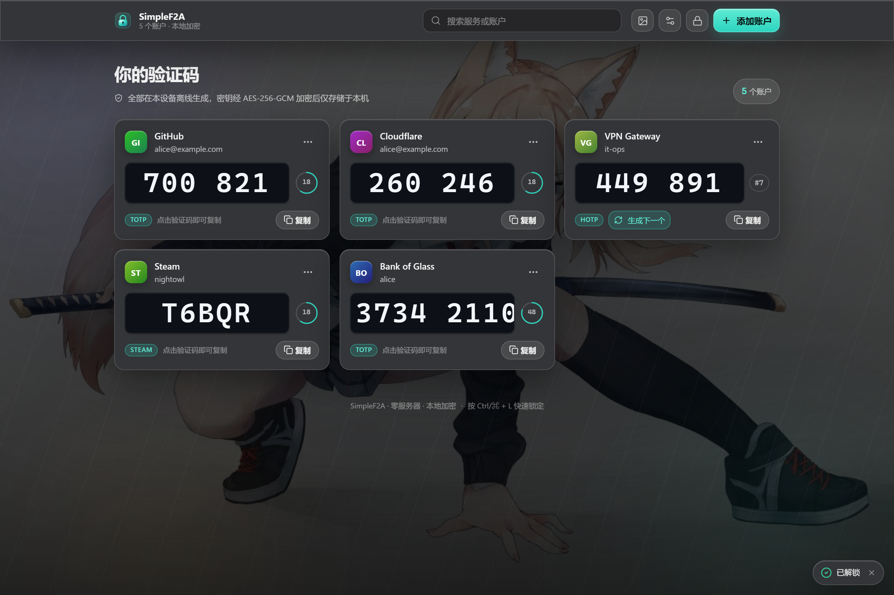

---

## 目录

- [快速开始](#快速开始)
- [功能特性](#功能特性)
- [界面截图](#界面截图)
- [技术栈](#技术栈)
- [架构](#架构)
- [安全设计](#安全设计)
- [液态玻璃设计系统](#液态玻璃设计系统)
- [性能说明](#性能说明)
- [测试](#测试)
- [部署](#部署)
- [项目结构](#项目结构)
- [集成测试与截图工具](#集成测试与截图工具)

---

## 快速开始

```bash
# 安装依赖（Node.js ≥ 20.19）
npm install

# 开发（http://localhost:5173）
npm run dev

# 生产构建（输出到 dist/）
npm run build

# 预览生产构建（http://localhost:4173）
npm run preview

# 单元测试
npm test

# 类型检查
npm run typecheck
```

> **必须通过 HTTPS 或 localhost 访问。** `crypto.subtle` 仅在安全上下文中可用，这是实现加密 vault 的硬性前提。

首次打开会要求设置主密码；之后每次打开（或锁定后）需重新输入。

---

## 功能特性

### OTP 类型

| 类型 | 算法 | 默认位数 | 周期/计数器 | 额外参数 |
| --- | --- | --- | --- | --- |
| **TOTP** | SHA1 / SHA256 / SHA512 | 6 | 30 秒 | 算法/位数/周期均可配置 |
| **HOTP** | SHA1 / SHA256 / SHA512 | 6 | 计数器 | 「生成下一个」按钮递增计数器 |
| **Steam Guard** | SHA1（固定） | 5 | 30 秒 | 26 字符字典编码，**不是数字截断** |
| **Yandex** | SHA256（固定） | 8 | 30 秒 | 需 PIN（4–16 位） |
| **MOTP** | MD5（固定） | 6 | 10 秒 | 需 PIN（4 位） |

标准 TOTP/HOTP 走成熟库 [`otpauth`](https://github.com/hectorm/otpauth)；Steam / Yandex / MOTP 由本仓库内部实现（otpauth 不覆盖）。

### 导入

- **手动输入** — Base32 密钥、issuer、账户名、类型、算法、位数、周期/计数器、PIN，实时校验
- **otpauth:// URI 粘贴** — 完整解析 Key URI Format（路径中的 `issuer:accountName` 与全部 query 参数）
- **二维码扫描** — 原生 `BarcodeDetector` + 摄像头流；不支持时降级为「上传图片 + 粘贴 URI」
- **otpauth-migration:// 批量导入** — Google Authenticator 导出格式（自带最小 protobuf 解析器，无外部依赖）
- **JSON 备份导入** — 兼容 Aegis / 2FAS / Bitwarden / AndOTP / 本应用导出

### 导出

- **单账户** — 生成 `otpauth://` URI 与二维码（SVG 预览，可下载 PNG / SVG）
- **全量加密备份** — 密码加密的 AES-256-GCM JSON，与本地存储同一套 PBKDF2 派生逻辑
- **全量明文备份** — 必须通过危险确认并手动输入「导出明文」

### 其他

- **服务图标** — 三级回退：内置品牌 SVG（GitHub / Steam / Claude / Cloudflare / Google / Discord 等 20+）→ 联网抓取真实 favicon（可在设置中关闭）→ 首字母派生色
- 搜索筛选、按 issuer 分组（单账户服务自动扁平化，避免稀疏布局）
- 一键复制 + 短暂反馈（亮边闪烁 + Toast）
- 倒计时环（线性平滑过渡，剩余 ≤5s 转暖琥珀色，不闪烁）
- 页面隐藏自动锁定（可配置）、`Ctrl/⌘ + L` 手动锁定
- 修改主密码（旧密钥解出 → 新密钥重加密全部记录）
- PWA：离线缓存、添加到主屏幕、安全区适配
- 深色 / 浅色双主题完整打磨（非简单反色）

---

## 界面截图

| 解锁 / 首次设置 | 空状态 |
| --- | --- |
| 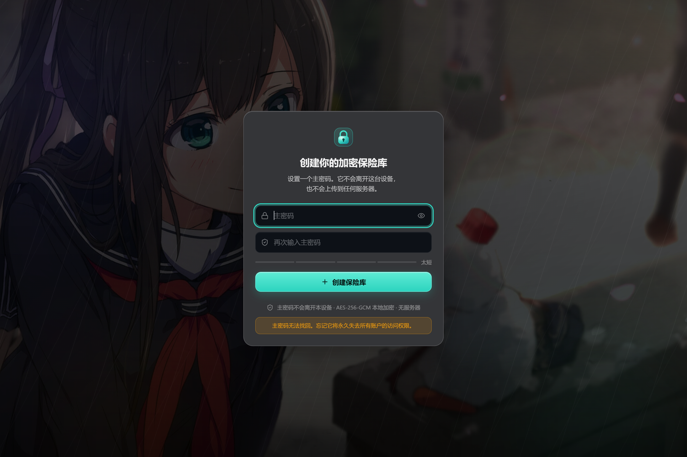 | 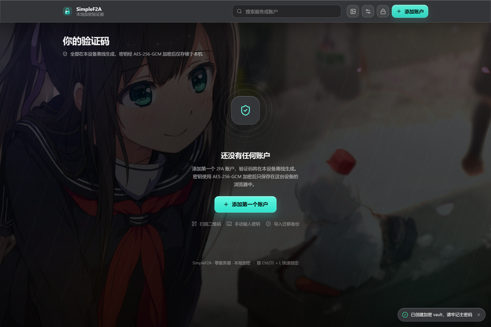 |

| 账户列表（深色 · 折射可见） | 浅色模式 |
| --- | --- |
|  | 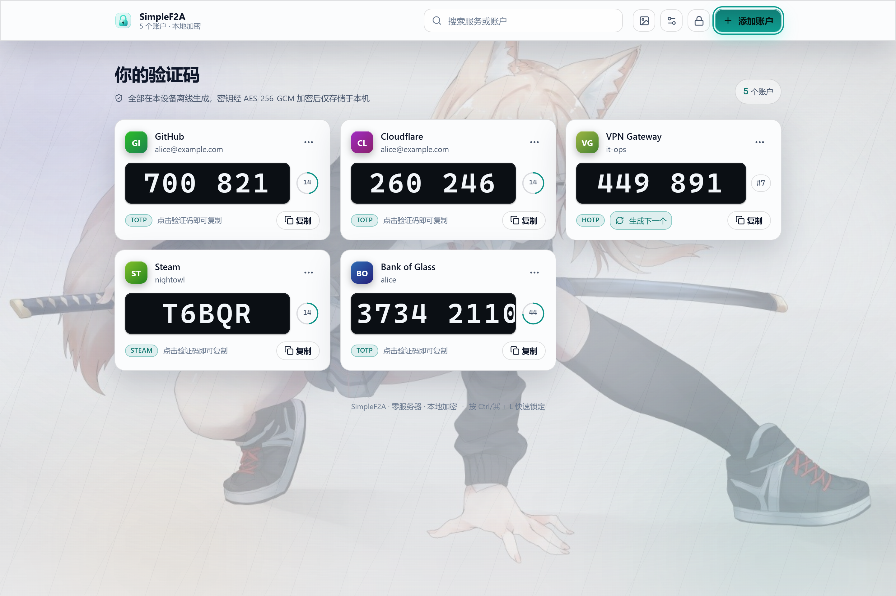 |

| 添加账户（扫码） | 添加账户（手动） |
| --- | --- |
| 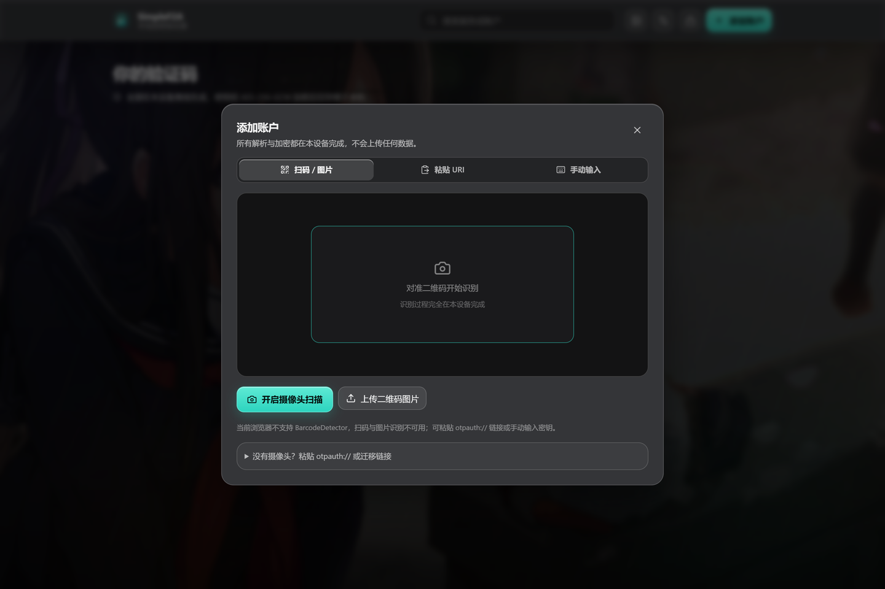 | 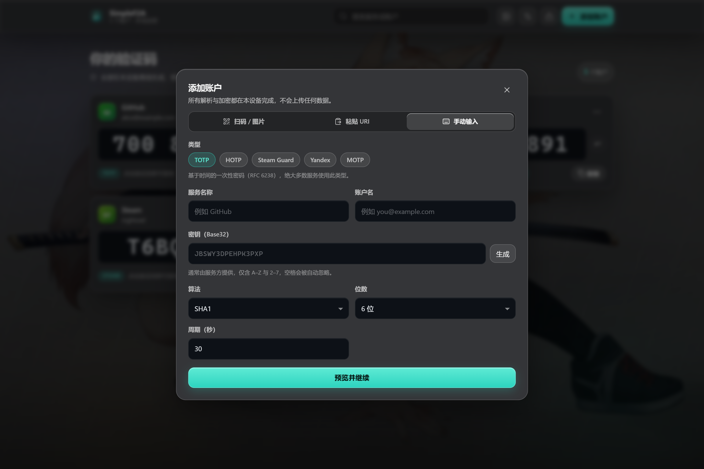 |

| 服务图标（内置品牌 + 联网 favicon） |
| --- |
| 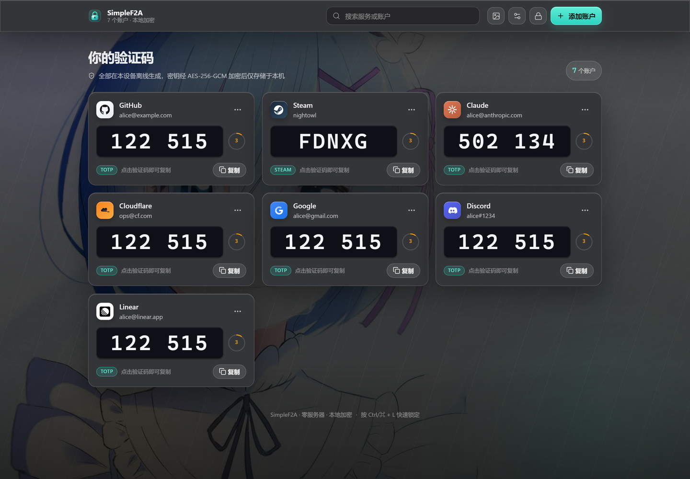 |

| 设置 / 备份 | Tier C 降级 |
| --- | --- |
| 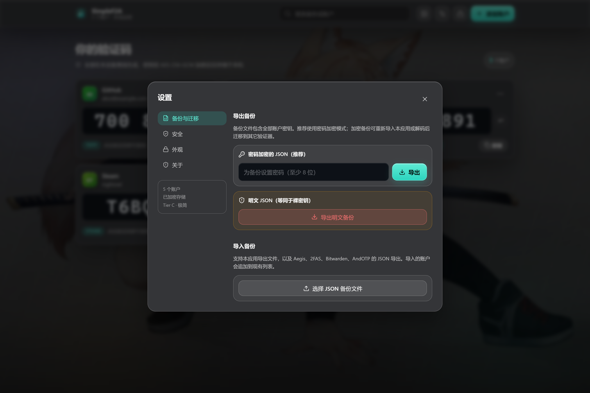 | 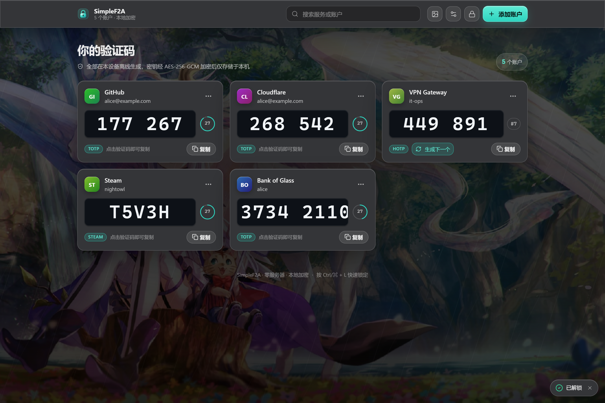 |

| 移动端 375px | 移动端底部抽屉 |
| --- | --- |
| 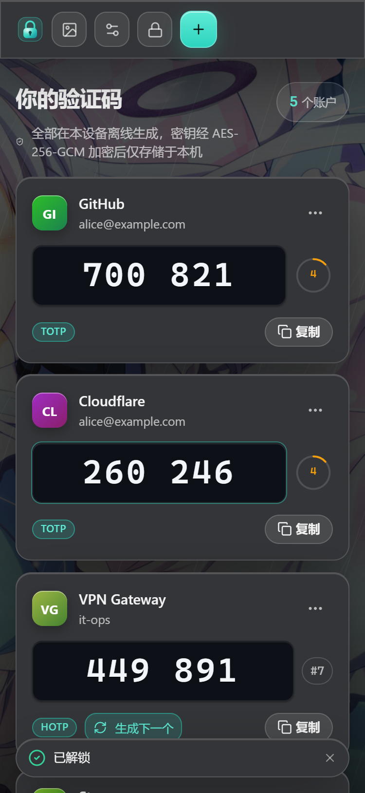 | 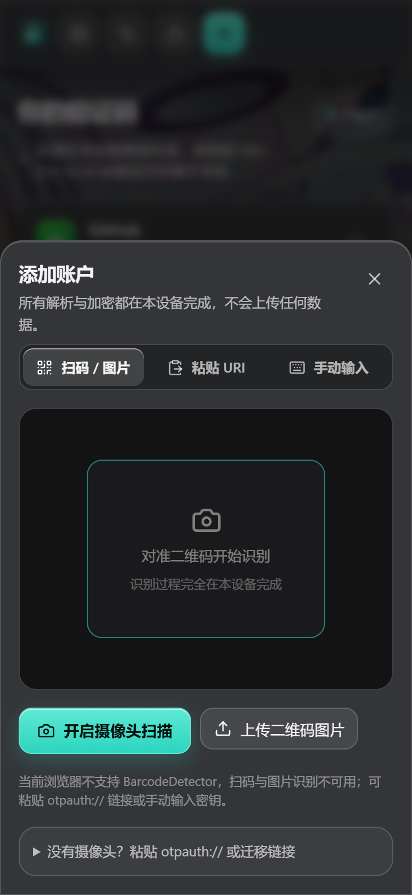 |

> 账户列表截图中，卡片边缘可见背景图片被弯折与色相偏移（蓝色/青色光晕沿边缘流动），而验证码所在的内层保持完全不透明、无折射。重新生成全部截图：`npm run build && npm run preview` 后执行 `node tools/screenshots.mjs`。

---

## 技术栈

| 领域 | 选型 | 说明 |
| --- | --- | --- |
| 框架 | React 19 + TypeScript + Vite 8 | 纯静态导出，无服务端依赖 |
| OTP | `otpauth` 9.x | 标准 TOTP/HOTP；扩展类型自实现 |
| 加密 | **Web Crypto API** | AES-256-GCM + PBKDF2-SHA256，零第三方加密库 |
| 存储 | `idb` | IndexedDB，只存密文 |
| 二维码 | `qrcode` | 生成 SVG / DataURL |
| 扫码 | `BarcodeDetector` | 原生 API，带降级路径 |
| PWA | `vite-plugin-pwa` (Workbox) | 预缓存 + 离线 |
| 图标 | `lucide-react` | 统一线宽，无 emoji |
| 测试 | Vitest | RFC 公开测试向量 |

---

## 架构

```
src/
├── otp/                   # OTP 核心（纯函数，可独立测试）
│   ├── base32.ts          # RFC 4648 编解码
│   ├── engine.ts          # TOTP/HOTP/Steam/Yandex/MOTP + MD5
│   ├── types.ts           # 类型规格与账户模型
│   ├── uri.ts             # otpauth:// 解析/生成
│   └── migration.ts       # Google Authenticator 迁移格式
├── vault/                 # 加密与持久化
│   ├── crypto.ts          # PBKDF2 + AES-GCM 原语
│   ├── db.ts              # IndexedDB (idb)
│   ├── vault.ts           # 生命周期：创建/解锁/锁定/改密/重置
│   └── backup.ts          # 导入导出（多格式兼容）
├── lib/
│   ├── tier.ts            # Tier A/B/C 自动降级判定
│   ├── background.ts      # 随机图片 API + 容灾
│   ├── qr.ts              # 二维码生成 + BarcodeDetector
│   ├── utils.ts           # 复制/下载/派生色
│   └── VaultProvider.tsx  # React 状态层
├── components/            # UI
└── styles/
    ├── design-tokens.css  # ★ 全部设计 Token
    ├── glass.css          # ★ 液态玻璃五步法 + 降级
    ├── components.css     # 组件样式
    └── global.css         # 背景层 + 基础
```

**数据流**：`主密码 → PBKDF2(600k) → CryptoKey(不可导出) → AES-GCM 加密每条记录 → IndexedDB`

---

## 安全设计

> 完整威胁模型见 [SECURITY.md](SECURITY.md)。

- **主密码永不存储** — 不写入 IndexedDB / localStorage / sessionStorage / Cookie
- **PBKDF2-SHA256 · 600,000 迭代**（OWASP 推荐）+ 每次随机 16 字节 salt
- **AES-256-GCM**，每条记录随机 12 字节 IV，AAD 绑定记录 id（防止密文搬移）
- **`extractable: false`** — 密钥无法被 `exportKey` 导出
- **内存卫生** — 锁定即丢弃 key 与明文；`visibilitychange` 自动锁定
- **严格 CSP** — 无 `unsafe-inline` / `unsafe-eval`
- **无网络回传** — 不发送 secret / OTP / 主密码

---

## 液态玻璃设计系统

### 五步法 → Token 映射

| 步骤 | 属性 | Token |
| --- | --- | --- |
| ① 模糊 | `backdrop-filter: blur()` | `--glass-blur` 8px / `--glass-blur-nav` 12px / `--glass-blur-modal` 16px |
| ② 增色 | `saturate()` | `--glass-saturate: 180%` |
| ③ 白色基底 | tint 渐变 | `--glass-tint` / `--glass-tint-strong` |
| ④ 1px 亮边 | 四向 inset box-shadow | `--glass-border-top` / `--glass-border-side` / `--glass-shadow` |
| ⑤ 边缘折射 | `feDisplacementMap` | `--glass-refraction-scale` 16 / `--glass-refraction-base-frequency` 0.014 / `--glass-refraction-octaves` 2 |

所有参数集中在 [`src/styles/design-tokens.css`](src/styles/design-tokens.css)，组件中无散落的魔法数字。

### 边缘折射实现

`feTurbulence`（分形噪声）→ `feGaussianBlur`（平滑位移场）→ `feDisplacementMap`（像素偏折）→ RGB 通道分离 0.6px 模拟色散。

关键约束：**位移只发生在边缘环带**。通过 `mask-image: radial-gradient(... transparent 52%, #000 96%)` 把中心区域完全遮掉，因此验证码所在的内层平面**永远不会**被滤镜重采样。

### 背景层

- 随机图片（4 个源顺序容灾，12s 超时，`` 天然受 CSP 白名单约束）
- 图片 `object-fit: cover` 全屏铺满，加载完成后 **1s 淡入**覆盖在渐变之上
- 之上叠加**暗色遮罩**（`--bg-overlay` + 中心提暗 `--bg-overlay-center`），保证任何图片上正文可读
- 三层大尺度径向光斑（teal / indigo / amber，`blur(90px)`，26s `translate3d` 漂移）
- 极细斜向线条纹理（`opacity ≤ 0.04`），给玻璃边缘一个"可弯"的东西
- 全部失败时平滑保留 CSS 渐变兜底；图片本身**完全静态**（无 CSS 动画）

### Tier A / B / C 降级

| 层级 | 条件 | 效果 |
| --- | --- | --- |
| **A** | 支持 backdrop-filter + SVG filter，CPU 核心 > 4，内存 > 4GB，首帧 < 260ms，实测帧率 ≥ 45fps | blur + saturate + tint + 亮边 + **SVG 边缘折射** |
| **B** | 硬件较弱 / 首帧超预算 / 实测帧率不足 / 不支持 SVG filter | blur + saturate + tint + 亮边（纯 CSS） |
| **C** | `prefers-reduced-transparency: reduce` 或不支持 backdrop-filter | 半透明纯色 + 边框，关闭 backdrop-filter |

降级在运行时自动判定（`src/lib/tier.ts`），**没有**"关闭效果的开关"。层级只会下调不会上调（避免闪烁），并在 `sessionStorage` 中记忆本次会话的降级结论。

阈值全部集中在 `TIER_THRESHOLDS` 常量中：

```ts
minCores: 4, minDeviceMemory: 4, firstFrameBudgetMs: 260, minScrollFps: 45
```

---

## 性能说明

### 参数预算

| 项 | 值 |
| --- | --- |
| 卡片 blur 半径 | **8px**（上限 12px，Modal 16px，绝不 > 16px） |
| 导航 blur 半径 | **12px** |
| 折射 scale | 卡片 **16**，导航 **20**（设计区间 8–18，导航取上限） |
| 折射 baseFrequency | 0.014，numOctaves 2 |
| 移动端首屏玻璃卡片 | **1**（单列） |
| 桌面端卡片列数 | 2–3（`minmax(328px, 1fr)` 自适应） |
| 渲染隔离 | 卡片使用 `contain: layout style`（**不用** `content-visibility: auto`，它会裁掉溢出与内阴影导致倒计时环被切） |
| 背景动画 | 仅光斑的 `transform: translate3d`，图片本身零动画 |

### 实测数据

环境：Windows / Microsoft Edge（Chromium）headless，1440×960，24 个账户，滚动 120 帧。

| 场景 | 平均帧率 | P95 帧耗时 | 超过 33.4ms 的帧 |
| --- | --- | --- | --- |
| 无节流 | **242.2 fps** | 4.4 ms | 0 |
| **6x CPU 节流** | **172.6 fps** | 16.6 ms | 1 |

首屏指标（本地 preview）：DCL 51ms，load 52ms，First Paint 464ms。

> 说明：headless Chromium 的 `requestAnimationFrame` 不受显示器垂直同步限制，因此平均帧率会高于 60fps；有意义的指标是 **P95 帧耗时**——6x 节流下为 16.6ms（约等于 60fps 单帧预算），**远优于 45fps（22.2ms）的验收线**。
>
> 复现命令：`npm run build && npm run preview`，另开终端 `node tools/perf.mjs`。

### 构建体积

| 产物 | 体积 | gzip |
| --- | --- | --- |
| JS | 366 KB | **120 KB** |
| CSS | 41 KB | **8.4 KB** |
| PWA 预缓存 | 10 项 / 511 KB | — |

---

## 测试

```bash
npm test
```

**65 个单元测试**，覆盖：

| 套件 | 内容 |
| --- | --- |
| `otp/base32.test.ts` | RFC 4648 编解码向量、宽松输入、校验 |
| `otp/engine.test.ts` | **HOTP RFC 4226 附录 D 全部 10 个向量**；**TOTP RFC 6238 附录 B 的 SHA-1/256/512 向量**；±1 周期漂移校验；Steam 字典编码；Yandex PIN 依赖；MOTP 的 MD5（RFC 1321 测试套件）；动态截断 |
| `otp/uri.test.ts` | Key URI 全字段解析、路径/query issuer 优先级、HOTP counter、Steam/MOTP 强制参数、错误输入拒绝、URI 往返 |
| `otp/migration.test.ts` | Google 迁移格式单条/多条解析、HOTP+SHA256、base64url 变体、垃圾载荷拒绝 |
| `vault/crypto.test.ts` | 往返加解密、每次随机 IV、错误密码拒绝、**GCM 篡改检测**、**AAD 跨记录搬移拒绝**、`extractable: false` 断言、备份往返、Aegis/2FAS/Bitwarden/AndOTP 导入 |

所有测试向量均来自 RFC 公开附录或公开规范，**不含任何真实凭据**。

---

## 部署

构建产物是纯静态文件（`dist/`），可部署到任意静态托管。

### Cloudflare Pages / Netlify

仓库已包含 `public/_headers`（会复制到 `dist/`），自动带上完整安全响应头（含 `frame-ancestors` / HSTS）。

```
Build command:  npm run build
Output dir:     dist
```

### Vercel

已包含 `vercel.json`，同样配置了安全响应头：

```bash
vercel deploy --prod
```

### GitHub Pages

`vite.config.ts` 已设置 `base: './'`（相对路径），可直接部署到子路径：

```bash
npm run build
# 将 dist/ 推送到 gh-pages 分支
```

> 注意：GitHub Pages 无法自定义响应头，因此只能依赖 `<meta>` 中的 CSP（不含 `frame-ancestors`）。

### 自定义域名 / 自托管

确保：
1. 通过 **HTTPS** 提供服务（`crypto.subtle` 前置条件）
2. 加上 `public/_headers` 中的响应头
3. SPA 回退到 `index.html`（本应用是单页，可直接用 hash 路由无关）

---

## 项目结构

```
.
├── index.html
├── vite.config.ts           # CSP 注入 + PWA 配置
├── design tokens
├── public/
│   ├── manifest.webmanifest
│   ├── favicon.svg
│   ├── _headers             # Cloudflare Pages / Netlify 安全头
│   └── icons/
├── src/                     # 应用源码（见「架构」）
├── screenshots/             # 关键界面截图
├── tools/
│   ├── screenshots.mjs      # 截图 + 冒烟测试
│   ├── perf.mjs             # 性能实测
│   └── upload-to-github.mjs # GitHub 上传辅助脚本
├── README.md
└── SECURITY.md
```

---

## 集成测试与截图工具

```bash
# 1. 构建并启动预览
npm run build
npm run preview

# 2. 另开终端：生成全部截图 + 冒烟测试
node tools/screenshots.mjs

# 3. 性能实测（含 6x CPU 节流）
node tools/perf.mjs
```

脚本会自动：创建 vault（真实 PBKDF2 600k）→ 通过 URI 与迁移链接批量添加账户 → 截图 → 检查移动端横向溢出 → 验证 Tier C 降级 → 输出性能数据。

> 本地预览默认监听 `[::1]:4173`（IPv6 回环）。如需改用 `127.0.0.1`，设置 `PREVIEW_URL` 环境变量。

---

## 上传到 GitHub

仓库提供了辅助脚本 `tools/upload-to-github.mjs`：自动完成「初始化 git 仓库 → 提交 → 通过 GitHub API 创建远端仓库 → 推送」。

**Token 不会写进代码。** 按优先级从以下位置读取：

```bash
# 方式 1：环境变量（推荐，仅当前终端有效）
$env:GITHUB_TOKEN="ghp_xxx"                 # PowerShell
export GITHUB_TOKEN="ghp_xxx"               # bash / zsh

# 方式 2：本地文件（已被 .gitignore 忽略）
cp .upload.env.example .upload.env          # 然后填入 GITHUB_TOKEN=ghp_xxx

# 方式 3：命令行临时传入
node tools/upload-to-github.mjs --token=ghp_xxx
```

使用：

```bash
node tools/upload-to-github.mjs                     # 提交并推送
node tools/upload-to-github.mjs --message "更新 UI"
node tools/upload-to-github.mjs --repo-name MyVault  # 自定义仓库名
node tools/upload-to-github.mjs --visibility public  # 公开仓库（默认 private）
```

脚本内置安全检查：会拒绝把 `.env` / `.upload.env` / `node_modules` / `dist` 加入暂存区。

**建议使用 Fine-grained PAT**，权限最小化：
- **Contents: Read and write**（必需）
- **Administration: Read and write**（仅首次自动创建仓库时需要；若你已在网页手动建好仓库则不需要）

> ⚠️ **Token 安全提示**：任何出现在聊天记录、日志或截图中过的 PAT 都应视为**已泄露**，请立刻到 GitHub → Settings → Developer settings → Personal access tokens 撤销并重新生成。不要把它硬编码进源码、提交进仓库或写进 README。

---

## 许可

MIT
