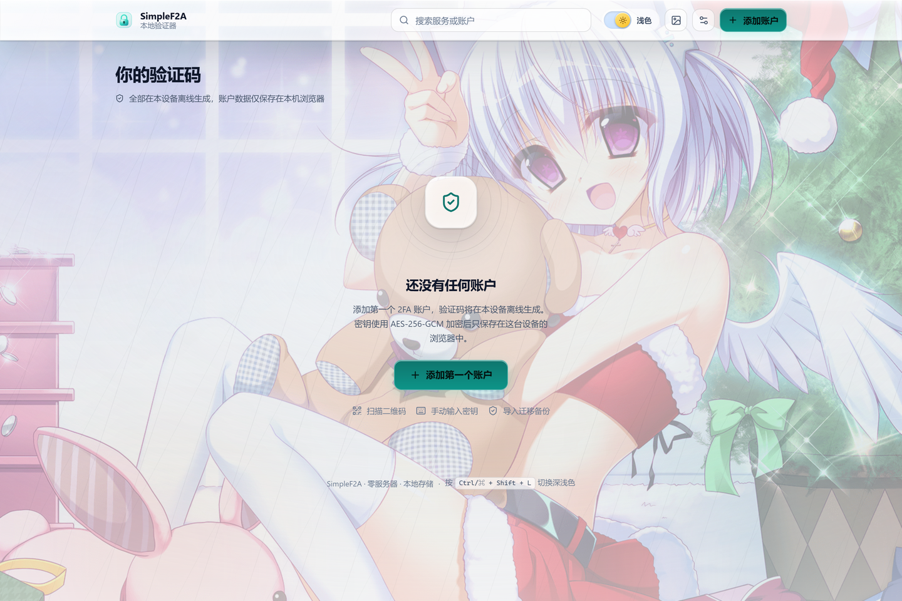
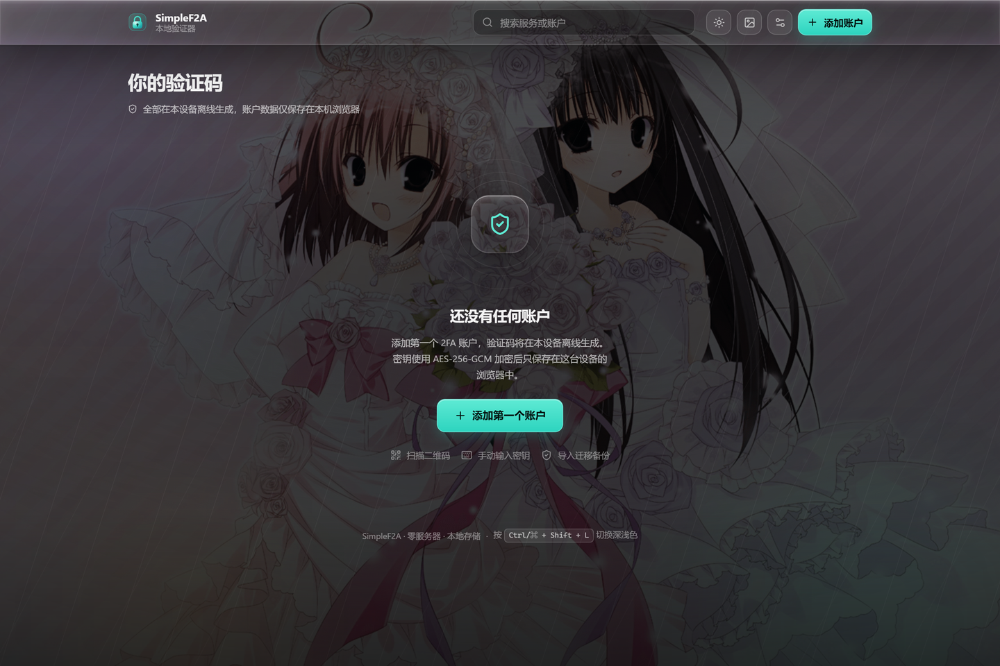
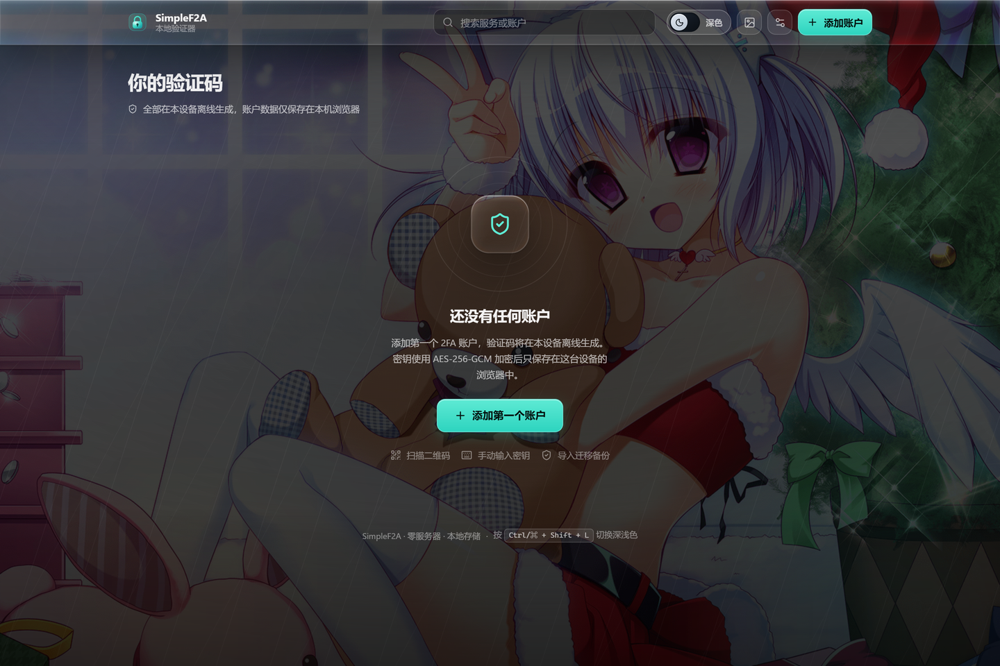
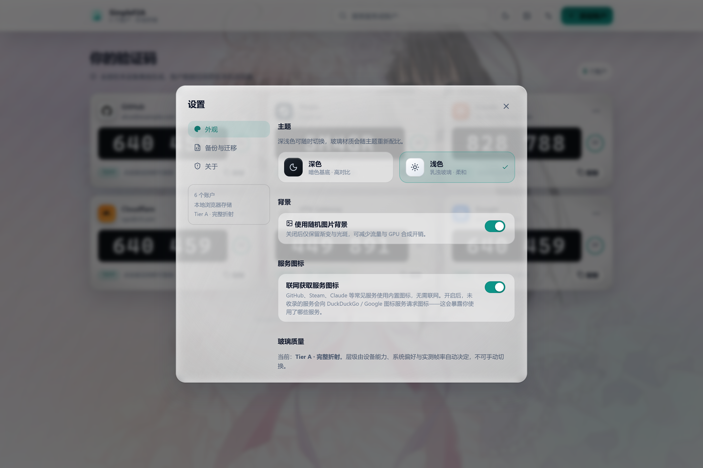
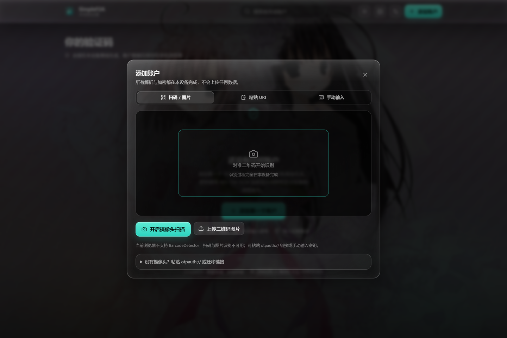
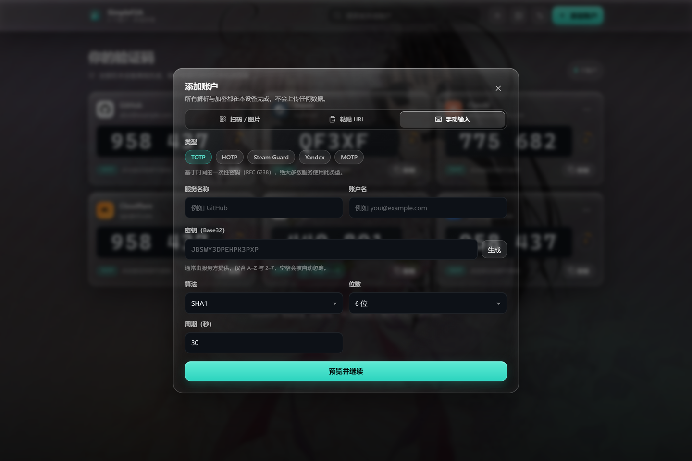
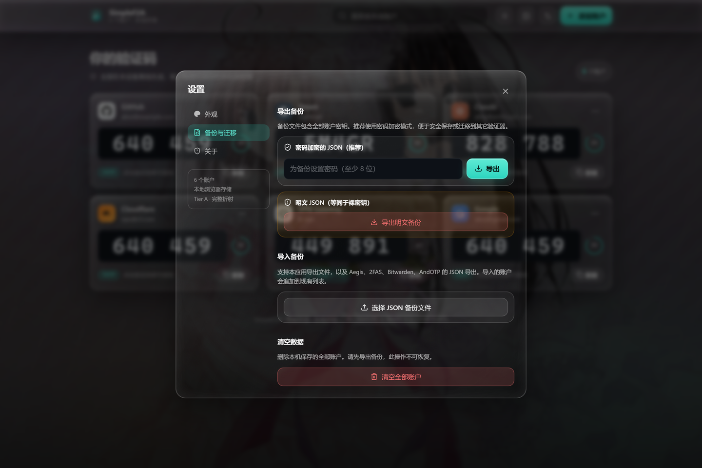
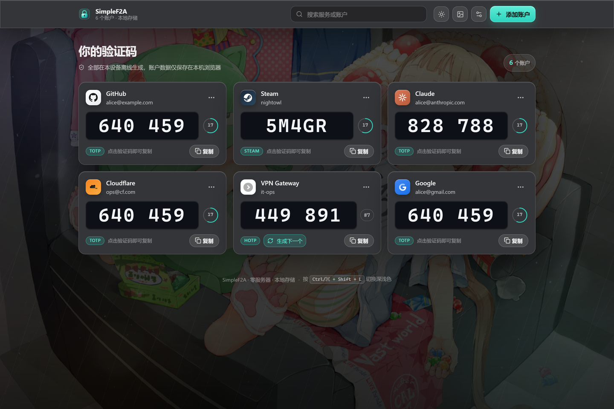
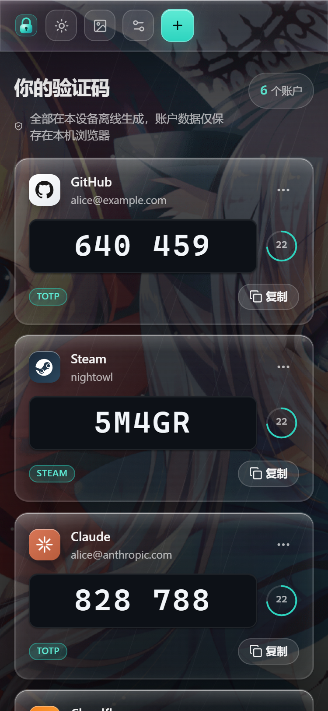
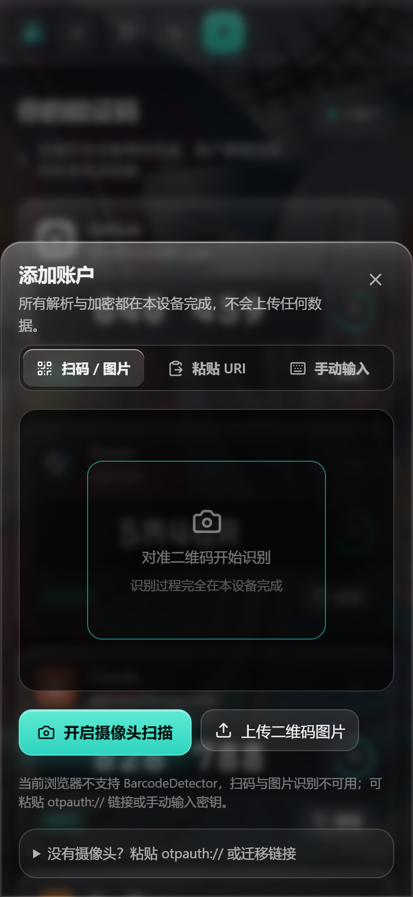

# SimpleF2A · 液态玻璃 · 零服务器双因素验证器

> 一个**纯前端、无服务器**的 2FA 验证器。打开即用，无需注册或主密码；账户数据保存在本机浏览器。UI 使用基于 SVG 位移贴图的液态玻璃材质系统，并以随机图片 API 作为折射光源。**玻璃是容器，验证码是主角。**

支持 **TOTP / HOTP / Steam Guard / Yandex / MOTP** 全部五种类型，可离线运行，可安装为 PWA，也可打包成 Windows 单文件 exe。



---

## 目录

- [快速开始](#快速开始)
- [Windows 桌面版（单文件 exe）](#windows-桌面版单文件-exe)
- [功能特性](#功能特性)
- [界面截图](#界面截图)
- [技术栈](#技术栈)
- [架构](#架构)
- [安全边界](#安全边界)
- [液态玻璃设计系统](#液态玻璃设计系统)
- [性能说明](#性能说明)
- [测试](#测试)
- [部署](#部署)
- [上传到 GitHub](#上传到-github)
- [项目结构](#项目结构)

---

## 快速开始

```bash
# 安装依赖（Node.js ≥ 20.19）
npm install

# 开发（http://localhost:5173）
npm run dev

# 生产构建（输出到 dist/）
npm run build

# 预览生产构建（http://localhost:4173）
npm run preview

# 单元测试
npm test

# 类型检查
npm run typecheck
```

> **必须通过 HTTPS 或 localhost 访问。** `crypto.subtle` 仅在安全上下文中可用（OTP 计算依赖它）。

**打开即用** —— 没有登录、没有主密码。首次进入显示空状态，点击「添加第一个账户」即可开始。

---

## Windows 桌面版（单文件 exe）

```bash
npm run exe
```

自动完成 `build` → 打包 → 复制 **到桌面**，得到 `SimpleF2A.exe`（约 89 MB，内含 Node 运行时与全部前端资源）。

**双击运行后**：

1. **不弹命令行窗口**，直接常驻**系统托盘**
2. 自动用默认浏览器打开应用页面（`http://127.0.0.1:48620/`）
3. 服务**只监听 127.0.0.1**，局域网内其它设备无法访问
4. 点浏览器关闭标签页不会停止服务，托盘图标仍在

**托盘图标操作**：

| 操作 | 效果 |
| --- | --- |
| 左键单击 / 双击 | 重新打开应用页面 |
| 右键 → 打开 SimpleF2A | 同上 |
| 右键 → 复制访问地址 | 地址写入剪贴板（并弹气泡提示） |
| 右键 → 刷新页面 | 让已打开的页面重新载入 |
| 右键 → 退出 | 停止服务并清理临时文件 |

> 实现方式：Node 主进程通过 `tools/tray-host.ps1` 拉起一个隐藏的 PowerShell（WinForms `NotifyIcon`）作为托盘宿主，两者用临时命令文件通信。脚本写入时带 **UTF-8 BOM**（Windows PowerShell 5.1 无 BOM 会按 ANSI 解码，中文会乱码导致语法错误）。

自定义输出路径：

```bash
node tools/build-exe.mjs --out "D:\Tools\SimpleF2A.exe"
```

> 端口从 `48620` 起试，被占用时自动顺延。exe 是单文件、可移动的，但**账户数据不跟着 exe 走**——数据保存在浏览器的 IndexedDB 里，并按访问地址隔离。换端口启动会看到空的账户列表；请固定从默认端口启动，或先导出备份再导入。

---

## 功能特性

### OTP 类型

| 类型 | 算法 | 默认位数 | 周期/计数器 | 额外参数 |
| --- | --- | --- | --- | --- |
| **TOTP** | SHA1 / SHA256 / SHA512 | 6 | 30 秒 | 算法/位数/周期均可配置 |
| **HOTP** | SHA1 / SHA256 / SHA512 | 6 | 计数器 | 「生成下一个」按钮递增计数器 |
| **Steam Guard** | SHA1（固定） | 5 | 30 秒 | 26 字符字典编码，**不是数字截断** |
| **Yandex** | SHA256（固定） | 8 | 30 秒 | 需 PIN（4–16 位） |
| **MOTP** | MD5（固定） | 6 | 10 秒 | 需 PIN（4 位） |

标准 TOTP/HOTP 走成熟库 [`otpauth`](https://github.com/hectorm/otpauth)；Steam / Yandex / MOTP 由本仓库内部实现。

### 导入

- **手动输入** — Base32 密钥、issuer、账户名、类型、算法、位数、周期/计数器、PIN，实时校验
- **otpauth:// URI 粘贴** — 完整解析 Key URI Format
- **二维码扫描** — 原生 `BarcodeDetector` + 摄像头流；不支持时降级为「上传图片 + 粘贴 URI」
- **otpauth-migration:// 批量导入** — Google Authenticator 导出格式（自带最小 protobuf 解析器，无外部依赖）
- **JSON 备份导入** — 兼容 Aegis / 2FAS / Bitwarden / AndOTP / 本应用导出

### 导出

- **单账户** — 生成 `otpauth://` URI 与二维码（SVG 预览，可下载 PNG / SVG）
- **全量加密备份** — 密码加密的 AES-256-GCM JSON（PBKDF2 600k）
- **全量明文备份** — 必须通过危险确认并手动输入「导出明文」

### 界面

- **深色 / 浅色切换** — 顶栏有一个**带滑轨和文字标签的开关**（深色态显示月亮，浅色态显示黄色太阳 + 「浅色」字样），一眼可辨；另外设置里有主题卡片，快捷键 `Ctrl/⌘ + Shift + L`。偏好持久保存，玻璃材质随主题重新配比
- **服务图标三级回退** — 内置品牌 SVG（GitHub / Steam / Claude / Cloudflare / Google / Discord 等 20+）→ 联网抓取真实 favicon（可在设置中关闭）→ 首字母派生色
- **morphicons 动效图标** — 复制→对勾、太阳→月亮均为真实 path morph（spring 物理），跟随 `prefers-reduced-motion`
- 搜索筛选、按 issuer 分组（单账户服务自动扁平化）
- 一键复制 + 短暂反馈（亮边闪烁 + Toast）
- 倒计时环（平滑过渡，剩余 ≤5s 转暖琥珀色，不闪烁）
- PWA：离线缓存、添加到主屏幕、安全区适配

---

## 界面截图

| 空状态（打开即进入） | 深色 · 液态玻璃 |
| --- | --- |
|  |  |

| 浅色 · 乳浊玻璃 | 设置 · 外观与主题 |
| --- | --- |
|  |  |

| 添加账户 · 扫码 | 添加账户 · 手动输入 |
| --- | --- |
|  |  |

| 设置 · 备份与迁移 | Tier C 降级（降低透明度） |
| --- | --- |
|  |  |

| 移动端 375px | 移动端底部抽屉 |
| --- | --- |
|  |  |

> 深色列表截图中，卡片边缘可见背景图像被弯折与色相偏移，而验证码所在的内层保持完全不透明、无折射。
> 重新生成全部截图：`npm run build && npm run preview` 后执行 `npm run shots`。

---

## 技术栈

| 领域 | 选型 | 说明 |
| --- | --- | --- |
| 框架 | React 19 + TypeScript + Vite 8 | 纯静态导出，无服务端依赖 |
| OTP | `otpauth` 9.x | 标准 TOTP/HOTP；扩展类型自实现 |
| 图标 | **morphicons** + `lucide` | spring 物理的 path morphing 动画 |
| 存储 | `idb` | IndexedDB，数据不出本机 |
| 备份加密 | **Web Crypto API** | AES-256-GCM + PBKDF2-SHA256（仅用于导出备份） |
| 二维码 | `qrcode` | 生成 SVG / DataURL |
| 扫码 | `BarcodeDetector` | 原生 API，带降级路径 |
| PWA | `vite-plugin-pwa` (Workbox) | 预缓存 + 离线 |
| 测试 | Vitest | RFC 公开测试向量 |

---

## 架构

```
src/
├── otp/                   # OTP 核心（纯函数，可独立测试）
│   ├── base32.ts          # RFC 4648 编解码
│   ├── engine.ts          # TOTP/HOTP/Steam/Yandex/MOTP + MD5
│   ├── types.ts           # 类型规格与账户模型
│   ├── uri.ts             # otpauth:// 解析/生成
│   └── migration.ts       # Google Authenticator 迁移格式
├── vault/                 # 存储与备份
│   ├── db.ts              # IndexedDB（账户明文 JSON）
│   ├── vault.ts           # 账户读写 API
│   ├── crypto.ts          # 仅用于「加密备份」导出
│   └── backup.ts          # 导入导出（多格式兼容）
├── lib/
│   ├── tier.ts            # Tier A/B/C 自动降级判定
│   ├── background.ts      # 随机图片 API + 容灾
│   ├── favicon.ts         # 联网图标抓取 + 缓存
│   ├── qr.ts              # 二维码生成 + BarcodeDetector
│   └── VaultProvider.tsx  # React 状态层（主题/数据/背景/Toast）
├── components/            # UI（含 morphicons 图标层 Icons.tsx）
└── styles/
    ├── design-tokens.css  # ★ 全部设计 Token
    ├── glass.css          # ★ 液态玻璃五步法 + 降级
    ├── components.css     # 组件样式（含主题切换过渡）
    └── global.css         # 背景层 + 基础
```

---

## 安全边界

> 完整说明见 [SECURITY.md](SECURITY.md)。

⚠️ **重要**：本应用**不使用主密码**，账户数据以明文 JSON 存储在浏览器 IndexedDB 中。

- **保护边界是浏览器 profile**：同一台电脑、同一个浏览器用户下，任何能打开该地址的人都能看到你的验证码
- **不经过任何服务器**：无网络回传，密钥不上传
- **导出即可加密**：备份文件支持密码加密（AES-256-GCM + PBKDF2 600k），适合安全存档与迁移
- **建议**：在私人设备上使用；公用电脑用完请清除站点数据；始终保留一份加密备份
- **防 XSS**：严格 CSP，无 `unsafe-inline` / `unsafe-eval`

若你需要在他人可访问的设备上使用，请自行加上操作系统账户密码或浏览器配置文件隔离。

---

## 液态玻璃设计系统

### 五步法 → Token 映射

| 步骤 | 属性 | Token |
| --- | --- | --- |
| ① 模糊 | `backdrop-filter: blur()` | `--glass-blur` 8px / `--glass-blur-nav` 12px / `--glass-blur-modal` 16px |
| ② 增色 | `saturate()` | `--glass-saturate: 180%` |
| ③ 白色基底 | tint 渐变 | `--glass-tint` / `--glass-tint-strong` |
| ④ 1px 亮边 | 四向 inset box-shadow + 内部辉光 + 底缘暗边 | `--glass-border-top` / `--glass-inner-glow` / `--glass-bottom-edge` |
| ⑤ 边缘折射 | `feDisplacementMap` | `--glass-refraction-scale` 16 / `--glass-refraction-base-frequency` 0.014 / `--glass-refraction-octaves` 2 |

质感增强（参考开源液态玻璃项目的做法）：

- **镜面扫光** — `115deg` 对角高光，模拟真实玻璃表面反射光源的方向感，hover 时增强
- **内部散射辉光** — `inset 0 0 18px` 柔光，光线在玻璃体内扩散
- **底缘暗边** — 下沿 `1px` 暗线，强化厚度感
- **折射层低模糊** — 折射层 blur 仅为主层 50%，让背景细节透过来，避免整面发灰

所有参数集中在 [`src/styles/design-tokens.css`](src/styles/design-tokens.css)，组件中无散落的魔法数字。

### 边缘折射实现

`feTurbulence`（分形噪声）→ `feGaussianBlur`（平滑位移场）→ `feDisplacementMap`（像素偏折）→ RGB 通道分离 0.6px 模拟色散。

关键约束：**位移只发生在边缘环带**。通过 `mask-image: radial-gradient(... transparent 50%, #000 94%)` 把中心区域完全遮掉，因此验证码所在的内层平面**永远不会**被滤镜重采样。

### Tier A / B / C 降级

| 层级 | 条件 | 效果 |
| --- | --- | --- |
| **A** | 支持 backdrop-filter + SVG filter，CPU 核心 > 4，内存 > 4GB，帧率达标 | blur + saturate + tint + 亮边 + **SVG 边缘折射** |
| **B** | 硬件较弱 / 实测帧率不足 / 不支持 SVG filter | blur + saturate + tint + 亮边（纯 CSS） |
| **C** | `prefers-reduced-transparency: reduce` 或不支持 backdrop-filter | 半透明纯色 + 边框，关闭 backdrop-filter |

降级在运行时自动判定（`src/lib/tier.ts`），**没有**手动开关。层级只会下调不会上调。

> 注意：若系统开启了「降低透明度」（部分 Linux 桌面、无头浏览器默认开启），应用会走 Tier C —— 这是对无障碍偏好的正确响应。

---

## 性能说明

### 参数预算

| 项 | 值 |
| --- | --- |
| 卡片 blur 半径 | **8px**（Modal 16px，绝不 > 16px） |
| 导航 blur 半径 | **12px** |
| 折射 scale | 卡片 **16**，导航 **20** |
| 折射 baseFrequency | 0.014，numOctaves 2 |
| 移动端首屏玻璃卡片 | **1**（单列） |
| 桌面端卡片列数 | 2–3（`minmax(328px, 1fr)` 自适应） |
| 渲染隔离 | 卡片 `contain: layout style` |
| 背景动画 | 仅光斑的 `transform: translate3d`，图片零动画 |

### 实测数据

环境：Windows / Microsoft Edge（Chromium）headless，1440×960，24 个账户，滚动 120 帧。

| 场景 | 平均帧率 | P95 帧耗时 | 超过 33.4ms 的帧 |
| --- | --- | --- | --- |
| 无节流 | **242.2 fps** | 4.4 ms | 0 |
| **6x CPU 节流** | **172.6 fps** | 16.6 ms | 1 |

首屏指标（本地 preview）：DCL 51ms，load 52ms，First Paint 464ms。

> headless Chromium 的 `requestAnimationFrame` 不受垂直同步限制，有意义的指标是 **P95 帧耗时**——6x 节流下 16.6ms（约等于 60fps 单帧预算），**远优于 45fps（22.2ms）验收线**。
>
> 复现：`npm run build && npm run preview`，另开终端 `npm run perf`。

### 构建体积

| 产物 | 体积 | gzip |
| --- | --- | --- |
| JS（主包） | 400 KB | **132 KB** |
| JS（morphicons region 按需） | 12.7 KB | 5.7 KB |
| CSS | 46 KB | **9.1 KB** |

---

## 测试

```bash
npm test
```

**45 个单元测试**：

| 套件 | 内容 |
| --- | --- |
| `otp/base32.test.ts` | RFC 4648 编解码向量、宽松输入、校验 |
| `otp/engine.test.ts` | **HOTP RFC 4226 附录 D 全部 10 个向量**；**TOTP RFC 6238 附录 B 的 SHA-1/256/512 向量**；±1 周期漂移校验；Steam 字典编码；Yandex PIN 依赖；MOTP 的 MD5（RFC 1321 测试套件）；动态截断 |
| `otp/uri.test.ts` | Key URI 全字段解析、issuer 优先级、HOTP counter、Steam/MOTP 强制参数、错误输入拒绝、URI 往返 |
| `otp/migration.test.ts` | Google 迁移格式单条/多条解析、HOTP+SHA256、base64url 变体、垃圾载荷拒绝 |
| `vault/crypto.test.ts` | 备份加解密往返、每次随机 IV、错误密码拒绝、**GCM 篡改检测**、**AAD 上下文绑定**、`extractable: false`、多格式备份导入（Aegis/2FAS/Bitwarden/AndOTP） |

所有测试向量均来自 RFC 公开附录或公开规范，**不含任何真实凭据**。

---

## 部署

构建产物是纯静态文件（`dist/`），可部署到任意静态托管。

### Cloudflare Pages / Netlify

仓库已包含 `public/_headers`（会复制到 `dist/`），自动带上完整安全响应头。

```
Build command:  npm run build
Output dir:     dist
```

### Vercel

已包含 `vercel.json`：`vercel deploy --prod`

### GitHub Pages

`vite.config.ts` 已设置 `base: './'`（相对路径），可直接部署到子路径。

---

## 上传到 GitHub

辅助脚本 `tools/upload-to-github.mjs` 自动完成「初始化仓库 → 提交 → 通过 API 创建远端仓库 → 推送」。

**Token 不写死。** 按优先级读取：环境变量 → 本地 `.upload.env` → 命令行参数。

```bash
$env:GITHUB_TOKEN="ghp_xxx"                 # PowerShell
export GITHUB_TOKEN="ghp_xxx"               # bash / zsh

node tools/upload-to-github.mjs                     # 提交并推送
node tools/upload-to-github.mjs --message "更新 UI"
node tools/upload-to-github.mjs --repo-name MyVault
```

> 若你把 token 直接写进脚本，GitHub 的 **Secret Scanning / Push Protection** 会拒绝该推送（报错 GH013 "Push cannot contain secrets"），需要在推送时点一次 GitHub 给出的放行链接。脚本中保留了 `HARDCODED_TOKEN` 常量位置，默认留空。

---

## 项目结构

```
.
├── index.html
├── vite.config.ts           # CSP 注入 + PWA 配置
├── public/
│   ├── manifest.webmanifest
│   ├── favicon.svg
│   ├── _headers             # Cloudflare Pages / Netlify 安全头
│   └── icons/
├── src/                     # 应用源码（见「架构」）
├── screenshots/             # 界面截图
├── tools/
│   ├── launcher.mjs         # exe 桌面启动器（内嵌资源 + 开浏览器）
│   ├── build-exe.mjs        # 打包 Windows 单文件 exe 到桌面
│   ├── screenshots.mjs      # 截图 + 冒烟测试
│   ├── perf.mjs             # 性能实测（含 6x CPU 节流）
│   └── upload-to-github.mjs # GitHub 上传辅助
├── README.md
└── SECURITY.md
```

---

## 许可

MIT
